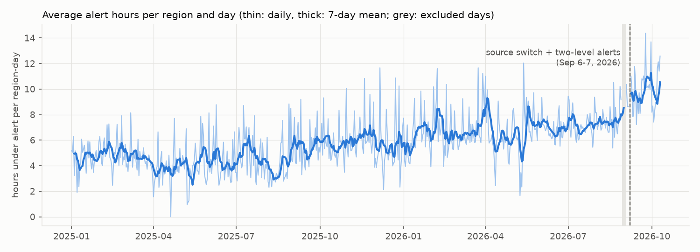
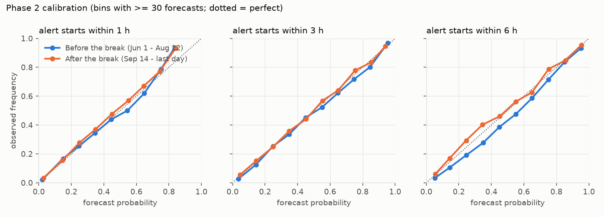

# ukraine-air-alert-forecast

Forecasting air raid alerts in Ukraine by region, with a strict no-look-ahead
evaluation on the most recent data and comparison against naive forecasts.

Two questions are answered for each of 24 regions (23 oblasts and Kyiv City),
and separately for each oblast's zone of regular alerts: the hromadas near the
front where alerts are declared almost every day (see [Zones](#zones-of-regular-alerts)):

- **Phase 1, the coming day.** At 00:00 Kyiv time: how many alerts will start in
  the region during this calendar day, and how many hours will it spend under
  alert (clipped to 00:00-24:00)?
- **Phase 2, the next hours.** At any hour: if no alert is in progress, what is
  the probability that one starts within 1, 2, ... 6 hours? If an alert is
  already in progress, the answer is "alert in progress", not a probability.

Inputs: the alert history and four Telegram channels (the Air Force, @war_monitor,
eRadar, @UkraineAlarmSignal), read from exported histories with the same
no-look-ahead discipline.

Status: stitched historical data (see [Data](#data)). The live API feeds
(Ukraine Alert API, alerts.in.ua) are not wired in yet.

## Results

Rolling-origin backtest: the models are refit every 7 days on everything known
at the refit moment and forecast the following week. Two test windows are
reported separately, because the data changes meaning between them (see
[the break](#the-break-in-the-series)). Every choice (zone definition, history
start, text channels, hyper-parameters) was made on an earlier validation window
(2026-03-02 .. 2026-05-31) and not touched afterwards; the trials are in
[Choices](#choices-made-on-the-validation-window).

<!-- RESULTS:START -->
#### Phase 1: alerts and alert hours per region for the coming Kyiv day (forecast at 00:00)

Mean absolute error per region-day. Skill = 1 - MAE(model) / MAE(best naive forecast), 90% interval from a day-level bootstrap.

| Window | Target | Days | Actual mean | Model MAE | Best naive forecast | Its MAE | Skill [90% CI] |
|---|---|---:|---:|---:|---|---:|---|
| Before the break (Jun 1 - Aug 22) | alerts | 83 | 2.97 | 1.328 | mean of last 7 days | 1.329 | +0.1% [-3.0%, +3.1%] |
| Before the break (Jun 1 - Aug 22) | hours | 83 | 7.17 | 1.462 | mean of last 7 days | 1.412 | -3.6% [-7.6%, +0.1%] |
| After the break (Sep 14 - last day) | alerts | 27 | 5.26 | 1.994 | mean of last 28 days | 2.026 | +1.6% [-3.1%, +5.8%] |
| After the break (Sep 14 - last day) | hours | 27 | 10.03 | 2.173 | mean of last 28 days | 2.197 | +1.1% [-6.5%, +7.8%] |

#### Phase 2: probability that an alert starts in the region within the next h hours

Scored only at moments with no alert in progress (otherwise the answer is "alert in progress"). BSS = Brier skill vs the 28-day climatology of the same region and hour of day, 90% bootstrap interval.

| Window | h | Forecasts | Base rate | Brier model | Brier climatology | BSS [90% CI] | AUC model | AUC climatology |
|---|---:|---:|---:|---:|---:|---|---:|---:|
| Before the break (Jun 1 - Aug 22) | 1 | 33446 | 0.123 | 0.0786 | 0.0823 | +4.5% [+3.6%, +5.4%] | 0.876 | 0.856 |
| Before the break (Jun 1 - Aug 22) | 2 | 33446 | 0.196 | 0.1019 | 0.1070 | +4.8% [+3.6%, +5.9%] | 0.884 | 0.868 |
| Before the break (Jun 1 - Aug 22) | 3 | 33446 | 0.248 | 0.1109 | 0.1166 | +4.9% [+3.7%, +6.1%] | 0.890 | 0.877 |
| Before the break (Jun 1 - Aug 22) | 4 | 33446 | 0.288 | 0.1157 | 0.1205 | +3.9% [+2.4%, +5.5%] | 0.892 | 0.883 |
| Before the break (Jun 1 - Aug 22) | 5 | 33446 | 0.320 | 0.1175 | 0.1218 | +3.5% [+1.7%, +5.0%] | 0.896 | 0.888 |
| Before the break (Jun 1 - Aug 22) | 6 | 33446 | 0.347 | 0.1196 | 0.1223 | +2.2% [-0.1%, +4.2%] | 0.898 | 0.891 |
| After the break (Sep 14 - last day) | 1 | 9080 | 0.250 | 0.1249 | 0.1403 | +10.9% [+8.9%, +13.1%] | 0.864 | 0.833 |
| After the break (Sep 14 - last day) | 2 | 9080 | 0.362 | 0.1342 | 0.1503 | +10.7% [+8.0%, +13.7%] | 0.878 | 0.859 |
| After the break (Sep 14 - last day) | 3 | 9080 | 0.428 | 0.1316 | 0.1471 | +10.5% [+7.4%, +13.5%] | 0.889 | 0.874 |
| After the break (Sep 14 - last day) | 4 | 9080 | 0.476 | 0.1282 | 0.1429 | +10.3% [+7.9%, +12.9%] | 0.897 | 0.884 |
| After the break (Sep 14 - last day) | 5 | 9080 | 0.512 | 0.1278 | 0.1382 | +7.5% [+4.7%, +10.2%] | 0.899 | 0.892 |
| After the break (Sep 14 - last day) | 6 | 9080 | 0.541 | 0.1261 | 0.1348 | +6.5% [+3.4%, +9.4%] | 0.902 | 0.897 |
<!-- RESULTS:END -->

What the numbers say:

- **Phase 1 shows no skill over a simple moving average.** In both test windows
  the model's error is within a few percent of the best naive forecast, and every
  interval includes zero; for alert hours before the break it is slightly worse
  (-3.6%). On the validation window the same model was 4-7% better than the naive
  forecasts, and that gain did not carry over. With alert history alone, the size
  of the next day's attack is not predictable beyond its recent average.
- **Phase 2 has a small, consistent edge.** The model beats the 28-day
  climatology at every horizon, by about 2-5% in Brier score before the break and
  7-11% after it, and its ranking of risky moments is better (higher AUC). Most
  of the gain comes from the current situation: neighbouring regions under alert,
  alerts in the last hours, the whole country's state.
- **Probabilities are well calibrated** (figure below). After the break the model
  slightly under-forecasts at longer horizons, which is expected: alerts became
  more frequent and the model has only a few post-break weeks to learn from.





## Data

| Source | Used for | Pinned commit | Licence |
|---|---|---|---|
| [Vadimkin/ukrainian-air-raid-sirens-dataset](https://github.com/Vadimkin/ukrainian-air-raid-sirens-dataset), `official_data_en.csv` (mirror of the official @air_alert_ua channel) | alerts that started before 2026-09-06 13:00 UTC | `bf0c323c78e3e4508721458797dcd38c95df13f3` | MIT |
| [JustJimer/ukraine-air-alert-stats](https://github.com/JustJimer/ukraine-air-alert-stats), `archive/alerts_in_ua.csv` (alerts.in.ua archive with red/yellow levels) | alerts that started at or after 2026-09-06 13:00 UTC | `7abc556ba5a0ff47a9e33c6abc136b8da3a9feb8` | none stated |

Both files are downloaded at the pinned commit by `alerts download` and checked
against `data_manifest.json` (sha256). Neither is committed: the alerts.in.ua
archive carries no licence, so this repository only redistributes code and
aggregate metrics.

| Telegram channel | Posts in the export | Used for |
|---|---|---|
| Air Force of the Armed Forces of Ukraine (@kpszsu) | 2019-02 .. 2026-10-11 | text features |
| @war_monitor | 2022-04 .. 2026-10-11 | text features |
| eRadar (@eRadarrua) | 2022-12 .. 2026-10-11 | text features |
| @UkraineAlarmSignal | 2022-02 .. 2026-10-11 | text features, cross-check of the series after the seam |

The channels' histories were exported with Telegram Desktop (HTML) and are
pinned by digest and post count in `data_manifest.json`
(`alerts telegram-pin <channel> <export folder>`). The exports are not committed
and cannot be downloaded by the pipeline; to rerun the text part, export the
same channels and pin them. See [Telegram channels](#telegram-channels).

### The break in the series

Three things happened to the alert history in late August and early September
2026, right inside the most recent period that the evaluation must cover:

1. The widely used volunteer dataset stopped tracking most alerts. In an
   exploratory check (outside this pipeline) it covered only about 21-22% of
   Kyiv City alert minutes after late August, measured against two independent
   references (Kyiv city open data and the alerts.in.ua archive). It is not used.
2. The official feed went silent: its last alert starts at 2026-09-07 05:28 UTC,
   and it has no alert starts at all on 2026-08-30 .. 09-01 (Kyiv time).
3. Two alert levels were introduced (yellow: drones, red: missiles). The first
   yellow alert in alerts.in.ua is at 2026-09-07 05:36 UTC, eight minutes after
   the official feed's last start.

What this project does about it:

- **Stitching.** Every alert is taken from exactly one source, chosen by its start
  time: the official feed before 2026-09-06 13:00 UTC, alerts.in.ua from then on.
  alerts.in.ua is complete only from about 2026-09-06 12:20 UTC (before that it
  holds just the alerts that were still active when collection started). On the
  16 hours where both sources are complete, alert minutes agree closely: the
  median Jaccard similarity over the 13 regions with alerts is 0.967, and 11 of
  13 are at 0.93 or above (`scripts/verify_stitch.py` recomputes this from the
  raw files). The exceptions are Zaporizhzhia (0.70) and Kherson (0.27):
  alerts.in.ua also issues alerts for occupied raions of Kherson oblast, which
  the official feed did not do in that window.
- **Excluded days.** 2026-08-29 .. 09-02 (the hole in the official feed and its
  partial edge days) and 2026-09-06 .. 09-07 (the seam) are neither trained on
  nor scored. Rolling features treat them as missing and are normalised by the
  number of valid hours in each window.
- **One alert definition across the break.** Yellow and red alerts are counted
  together, so that "an alert" keeps covering both drones and missiles, as the
  single-level system did. Even so, the series is not level across the break:
  summed over the 24 regions, the median day has 72 region alerts and 167 alert
  hours in June 1 - August 22, against 118 alerts and 240 hours in September 8 -
  October 10. These data cannot separate how much of the jump comes from the new
  yellow level, how much from the change of source, and how much from a real
  escalation.
- **Separate scores before and after.** Metrics are reported for a window before
  the break and for one after it, so a data change cannot hide inside an average.
  A `two_level_era` feature lets the model tell the periods apart once post-break
  weeks are in its training data.

### Region and alert definitions

- **An alert in a raion is an alert in its oblast.** Oblast- and raion-level
  alerts define the region's state: *none*, *part of the region* (some raions)
  or *whole region* (an oblast-level alert, or every raion at once). Raion names
  are matched across sources by the official 2010 transliteration standard, with
  three 2024 renames handled explicitly; all 118 raions match.
- **Hromada- and city-level alerts define the zones**, not the region. In
  frontline communities they are declared almost daily and some last for months
  (one in Kharkivskyi raion started 2024-05-12 and lasted about 14,500 hours);
  counted in the region, they would mark the whole oblast as permanently under
  alert. The region series is therefore the oblast outside its zone.
- **Crimea and Luhansk oblast are not modelled**: each has had one uninterrupted
  alert since 2022.
- **Counting alerts.** Overlapping or touching alerts within a region are one
  alert; alerts separated by any gap, even a few seconds, count separately. Under
  intense attacks an alert can be re-declared within a minute, or declared late,
  and that is a new alert. An alert is counted on the day it starts, so a night
  alert crossing midnight counts once.

### Zones of regular alerts

A hromada is in its oblast's zone on Kyiv day *d* if it had an alert on at
least 90% of the valid days among the 7 days before *d*. Membership is fixed at
*d*'s midnight from days that are over, so it uses nothing published later
(`scripts/verify_zones.py` recomputes it from the alert table as known at that
midnight). The zone's timeline is the union of its hromadas' own alerts, the
alerts of the raions they lie in, and oblast-level alerts. Its features describe
the history of the day's members, so a hromada that joins brings its past alerts
with it. The two parameters were chosen on the validation window (F1 of
"member on day *d*" against "alerts on at least 5 of the next 7 days").

- In 2023 the zone is Nikopol; from late 2023 to 2025 Marhanets,
  Chervonohryhorivka, Pokrovsk (Donetsk oblast), Kharkiv city and Zaporizhzhia
  city join. After the
  two-level system starts, alerts.in.ua lists cities as well, and Kryvyi Rih and
  Svitlovodsk (Kirovohrad oblast) become zones; the definition adapts by itself
  because it looks back only 7 days.
- alerts.in.ua lists a city and its hromada as two locations with the same alert
  (m. Kryvyi Rih and Kryvorizka hromada). All 1,089 city rows repeat a hromada
  alert (start and end within 2 minutes) and are dropped.
- Hromada alerts longer than 24 hours (2.1% of hromada records in 2023-2026, but
  46% of their hours) are kept: in the zone they count with the hours that fall
  in each day, and as one alert on the day they start.
- A zone exists only on days with members. Zones are modelled and scored
  separately from regions, with the same features, models and naive forecasts;
  the naive forecasts use the history of the day's members.

### History start

Training uses alerts from 2023-01-01. The official feed starts on 2022-03-15,
and a history from 2022-04-13 (four weeks later, so every lookback is filled)
was compared on the validation window: the two scored 0.8988 (with 2022) and
0.8969 (from 2023), a tie within noise. 2022 helped alert hours slightly and
hurt alert counts. Before 2022-03-15, alerts exist only as free text in
@UkraineAlarmSignal (sirens in single cities, curfew sirens, reports relayed
from comments); that text is not used: it cannot give a reliable oblast series.

### Telegram channels

- **Time.** The export gives each post's local time on the exporting machine
  (Europe/Warsaw, checked against t.me/s) without an offset. Warsaw and Kyiv
  switch daylight saving time at the same instant, so the conversion to UTC is
  exact; in the repeated autumn hour the order of post ids decides which hour a
  post belongs to.
- **Completeness.** The reader refuses a post without a date, and
  `scripts/verify_data.py` checks that the posts read equal the message blocks
  counted directly in the HTML.
- **Parser.** Rules (regular expressions) find the oblasts a post refers to (by
  name, the "-shchyna" form, the oblast centre, large towns and raion centres)
  and its types: drone, missile, ballistic, guided bomb, aviation, artillery,
  alert, all clear. Its accuracy is measured on a gold set (below).
- **Edited posts are kept.** The export holds only the final text and a flag
  that the post was edited, not when. Without an API this text is all there is,
  so the posts stay in; the flag is never a feature (it may have been set after
  the forecast moment). The run without edited posts is reported below.
- **Text features** (phase 1 and phase 2, from posts published before the
  moment): posts mentioning the region with a threat type over the last 1, 3, 6
  and 24 hours; drone, missile and guided-bomb mentions over 3 hours; all-clear
  posts in the last hour; threat mentions of neighbouring regions; country-wide
  threat, drone, missile and aviation posts; the channels' posting rate over 28
  days (most channels post little before mid-2023, and the model needs to know
  that silence then meant no coverage, not calm). At 00:00 the 6-hour window is
  the evening before the forecast day.
- **Gold set.** For each channel 200 posts were drawn at random (fixed seed)
  from posts with text since 2023-01-01, leaving out the posts looked at while
  the rules were written. The agent (Claude) labelled each post by reading it,
  without seeing the parser's output, by the guide in `src/alerts/gold.py`;
  Yehor Hunia reviewed every label, and his corrections are the gold labels.

## Choices made on the validation window

<!-- CHOICES:START -->
<!-- CHOICES:END -->

## No look-ahead

The task requires that nothing the model is trained on or uses as an input comes
from after the forecast moment. The main trap is in the data itself: an alert
appears in these files only after it has ended, with its finish time already
filled in.

- **Inputs.** Every feature at moment `t` is computed from alert starts at or
  before `t` and from the part of each alert that lies before `t`. An alert in
  progress at `t` is known only as "started at s, not over yet"; its duration is
  never used. The current state is a legitimate input because an alert is public
  the moment it is declared.
- **Labels.** Each training row carries the moment its label became known (the
  end of the day for phase 1, `t + h` for phase 2). A refit at moment `T` trains
  only on rows known by `T`.
- **Text.** A text feature at `t` counts only posts published before `t`. The
  final text of an edited post may differ from what was published at `t`; this
  is measured by the run without edited posts.
- **Test.** `scripts/verify_leakage.py` recomputes every feature of every region
  and existing zone, the text features included, at 34 moments (random ones plus
  the seam, DST switches and the start of two-level alerts) from (a) the alert
  table and the posts as they were known at that moment and (b) data with a
  rewritten future (later alerts and posts moved to random later times), and
  requires identical values. Two deliberately leaky control features (hours
  until the current alert ends; posts about the region in the next hour) must be
  caught by the same comparison, and are.

## Models and baselines

- Phase 1: two gradient-boosted regressors with Poisson loss (scikit-learn
  `HistGradientBoostingRegressor`), one for the alert count and one for alert
  hours; predicted hours are clipped to the length of the day (23-25 h on DST days).
- Phase 2: one gradient-boosted classifier per horizon; probabilities are made
  non-decreasing in the horizon.
- Regions and zones have separate models with the same specification.
- Features: the series' state and history over 1 h .. 28 days, time since the
  last alert, the same clock time on previous days, neighbouring regions, the
  whole country, the surrounding oblast (for a zone), Kyiv calendar time, the
  two-level flag, and the text features.
- Naive forecasts for phase 1: yesterday, the same weekday last week, means of
  the last 7 and 28 days. For phase 2: the frequency of alert starts in the same
  region and hour of day over the last 28 days (climatology), and a Poisson rate
  from the last 24 hours.

## How to run

Requires [uv](https://docs.astral.sh/uv/) (Python 3.12 is installed by uv).

```bash
uv sync
uv run alerts download     # pinned data -> data/raw/, checked against data_manifest.json
uv run alerts telegram-pin kpszsu ~/Downloads/<export folder>   # once per channel
uv run alerts backtest     # both phases, both windows -> reports/metrics_phase{1,2}.json
uv run alerts report       # figures and the results tables in this README
uv run alerts forecast --as-of 2026-10-10T18:00+00:00
```

Choices and side runs:

```bash
uv run alerts validate zones|history|text|edited   # validation trials -> reports/validation.json
uv run alerts tune                                 # hyper-parameters -> reports/tuning.json
uv run alerts gold review-page                     # local page to review the gold labels
uv run alerts gold import-review --file gold_review.json --reviewer "Name"
uv run alerts gold report                          # parser accuracy -> reports/parsers.json
uv run alerts ablate-edited                        # test windows without edited posts / text
uv run alerts crosscheck                           # series vs @UkraineAlarmSignal -> reports/crosscheck.json
```

The full backtest takes about 20-30 minutes on a laptop.

Checks:

```bash
uv run pytest
uv run python scripts/verify_data.py       # pinned data and exports match the manifest, exports read completely
uv run python scripts/verify_stitch.py     # stitched series recomputed from raw files
uv run python scripts/verify_counting.py   # alert counts recomputed with no gap merging
uv run python scripts/verify_zones.py      # zone membership as of each midnight, with a control
uv run python scripts/verify_leakage.py    # no look-ahead, with alert and text controls
uv run python scripts/verify_validation.py # every choice is the best trial on the validation window
uv run python scripts/verify_parsers.py --require-review   # gold set and parser accuracy
uv run python scripts/verify_ablation.py   # the run without edited posts
uv run python scripts/verify_crosscheck.py # series after the seam vs @UkraineAlarmSignal
uv run python scripts/verify_backtest.py phase1
uv run python scripts/verify_backtest.py phase2
uv run python scripts/verify_forecast.py   # CLI state agrees with the raw data
uv run python scripts/verify_repro.py      # a fresh run reproduces reports/ byte for byte
uv run python scripts/verify_readme.py     # tables here equal reports/*.json
```

## Limitations

- **Stitched, not live.** Training and scoring use two archives joined at a seam.
  Neither archive is versioned as "what was published when": if a source corrected
  an alert later, the correction is in the data. The no-look-ahead guarantee is
  about alert timestamps, not about dataset revisions.
- **The post-break window is short** (about four weeks) and the model has seen
  only a few post-break weeks at each refit. Its intervals are wide.
- **Kherson oblast changes meaning at the seam** (occupied raions appear in
  alerts.in.ua), and Zaporizhzhia agrees only partly.
- **Telegram exports, not feeds.** The text features come from exported
  histories with final (possibly edited) texts and no edit times. The exports
  cannot be redistributed, so the text part reproduces only with one's own
  exports of the same channels.
- **One validation window, several decisions.** Zones, history start, text
  channels and hyper-parameters were all chosen on the same 13 weeks; some of
  what looks like a gain there is noise, which is why the test windows are the
  numbers to read.
- **Not an early-warning system.** These are statistical forecasts for planning
  and analysis. Follow official alerts.

## Repository layout

```
src/alerts/     config, data loading, stitching, interval algebra, features,
                datasets, models, backtest, evaluation, forecast, report, CLI
scripts/        verification scripts used as acceptance gates
tests/          unit tests (intervals, three states, day bounds and DST, counting,
                zones, Telegram time and parser, text feature timing)
gold/           gold labels for the parser (post ids and labels, no texts)
reports/        validation, tuning and metric files, parser accuracy, figures (generated)
```
